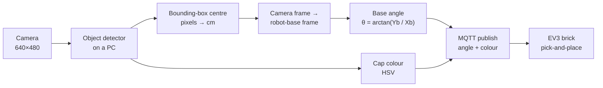

# Computer-Vision-Based Object Classifier Robotic Arm for Recycling

A LEGO Mindstorms EV3 robotic arm that detects plastic bottles and bottle caps with a deep-learning object detector, locates them on a work surface and sorts caps by colour.

> **BSc thesis, Addis Ababa Institute of Technology (AAiT), Addis Ababa University, 2022.**
> By **Leul Mengistu** and **Natnael Getachew**. Advisor: **Dr. Bisrat Derebssa**.
> Code and dataset are not public. This page documents the method and results.

**Demo video:** <!-- TODO: YouTube (unlisted) link -->

<!-- TODO: add assets/setup.jpg (work space) and assets/detections.jpg (model output) -->

---

## Motivation

Recycling plants still sort much of their waste by hand, which is slow, tiring and hazardous. Mechanical sorting shreds material before classifying it, which adds cost. This project explores a low-cost alternative: a camera and an object detector classify items, and a robotic arm picks and sorts them.

## System overview

The EV3 brick (300 MHz ARM, 64 MB RAM) is too weak to run a neural network. Detection therefore runs on a PC, which sends only the target angle and colour to the robot over MQTT.

## Method

### 1. Data

| Dataset | Contents | Use |
|---|---|---|
| 1 | TrashNet (public): 501 glass, 594 paper, 403 cardboard, 482 plastic, 410 metal images | First experiments |
| 2 | **Self-collected**: 278 images of plastic bottles and caps, caps labelled by colour | Detecting cap colour with the network |
| 3 | Same 278 images, caps labelled without colour | **Final model** |

Images were labelled with LabelImg (for TensorFlow) and makesense.ai (for YOLOv5).

### 2. Detection models (transfer learning)

- **SSD MobileNet V2 FPNLite 320×320** from the TensorFlow 2 Model Zoo (TF 2.7.0)
- **YOLOv5**

### 3. Localization

- Pixel-to-centimetre scale from the measured work space: 38 cm / 640 px ≈ 0.059 cm/px horizontally and 27.3 cm / 480 px ≈ 0.057 cm/px vertically
- Object centre taken from the bounding box: x = x_min + (x_max − x_min)/2, and likewise for y
- Translation from the camera frame to the robot-base frame: X_b = X_c − 18 cm, Y_b = Y_c

### 4. Control

- The base rotation angle is computed as θ = arctan(Y_b / X_b)
- The other joints follow a fixed pick-and-place routine
- Cap colour is read from the detected region in HSV colour space and decides the drop-off bin

## Results

| Model | Data | Result |
|---|---|---|
| SSD MobileNet V2 FPNLite | Dataset 1 (TrashNet), 30k steps | Loss fluctuated and stopped improving. Not used. |
| SSD MobileNet V2 FPNLite | Dataset 2 (colour-labelled caps) | Bottles detected well; cap colour unreliable |
| **SSD MobileNet V2 FPNLite** | **Dataset 3** | **Average precision 0.77, maximum average recall 0.80.** Chosen as the final model. |
| YOLOv5 | Colour-labelled caps | mAP 0.69; recall under 0.2 at confidence ≥ 0.5 |

<!-- CONFIRM against the written report: the exact metric definitions (e.g. AP@0.5 vs COCO mAP@[.5:.95], AR@100) -->

The final system sorted bottle caps by colour: the network detected the cap and HSV analysis classified its colour.

## Lessons and limitations

- **Colour is better handled outside the network.** With few images and a low-quality camera, training the detector to separate cap colours failed. Detecting a generic "cap" and classifying colour with HSV worked much better.
- **Small dataset.** About 280 images under one lighting setup, so the model would need more varied data to generalise.
- **Simplified kinematics.** Only the base angle is computed. Reach and height use a fixed routine, so objects must lie within a known band.
- **Planar assumption.** The pixel-to-cm mapping assumes a flat work surface at a fixed camera height.

## Future work

- Collect more varied data (lighting, backgrounds, depth)
- Full inverse kinematics for reach and height, not only the base angle
- A better camera, and a 3D-printed gripper

## My contribution

This was a two-person thesis. Natnael Getachew and I worked jointly on every part of the system: data collection and labelling, model training and evaluation, localization and coordinate transformation, the robot's control software and MQTT communication, and integrating the whole system.

## Acknowledgements

Dr. Bisrat Derebssa (advisor), Natnael Getachew (co-author), and the School of Electrical and Computer Engineering, AAiT.
